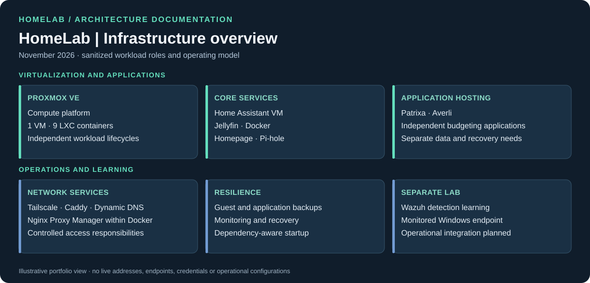

# HomeLab

> A continuously operated, Proxmox-based infrastructure lab for developing practical skills in Linux administration, networking, secure application hosting, monitoring, backup and recovery, and cybersecurity.

## Overview

This project documents the design, deployment, operation, and evolution of my personal HomeLab. It started as a small self-hosted server and has grown into a platform supporting virtual machines, Linux containers, Docker applications, smart-home automation, and security learning.

The objective is to practice the complete infrastructure lifecycle: design, deploy, secure, monitor, troubleshoot, recover, and improve.

| Focus area | Examples of practical experience |
| --- | --- |
| Virtualization | Proxmox VE, virtual machines, LXC, workload separation |
| Networking | DNS, reverse proxies, VPNs, HTTPS and access management |
| Application hosting | Containerized services, databases, scheduled maintenance |
| Observability | Prometheus, Grafana, uptime monitoring and system metrics |
| Resilience | Backups, restore verification, recovery and dependency-aware startup |
| Cybersecurity | Threat modeling, access restrictions, security monitoring and lab isolation |

> **Documentation note (November 2026):** This is a public portfolio, not a live infrastructure runbook. Network addresses, service endpoints, guest identifiers, private household details and live dashboard screenshots are deliberately omitted or replaced with illustrative values. The written documentation reflects the November workload inventory. The original architecture diagrams are retained as earlier design snapshots and should not be read as a current deployment inventory.

## Infrastructure at a glance

### Hardware

| Component | Specification |
| --- | --- |
| Main host | Lenovo ThinkCentre M720q Tiny |
| Processor | Intel Core i5-8500T, 6 cores / 6 threads |
| Integrated graphics | Intel UHD Graphics 630 |
| Memory | 16 GB DDR4 |
| System storage | 256 GB NVMe SSD |
| External storage | 3 TB HDD |
| Networking | Residential gateway and Gigabit Ethernet |
| Smart-home connectivity | Zigbee coordinator and smart-home bridge |

### Virtualization platform

Proxmox VE 9.x provides the main virtualization and containerization layer. The November 2026 inventory shows **one virtual machine and nine LXC containers**.

| Workload | Type | Purpose |
| --- | --- | --- |
| Home Assistant OS | VM | Smart-home automation |
| Jellyfin | LXC | Media streaming |
| Docker | LXC | Containerized applications and media management |
| Tailscale | LXC | Secure remote access |
| Homepage | LXC | Central infrastructure dashboard |
| Pi-hole | LXC | Local DNS and filtering |
| Patrixa | LXC | Self-hosted budgeting application |
| Caddy | LXC | Reverse proxy and HTTPS |
| Dynamic DNS | LXC | Dynamic DNS management |
| Averli | LXC | Self-hosted budgeting application |

Workloads are separated according to their resource requirements, responsibilities, update cycles and recovery needs. Automatic startup and dependency-aware startup ordering have been configured to improve recovery following a host restart.

Guest names, exact versions, resource utilization and administrative identities are omitted from the public inventory. The workload count is a point-in-time observation, not an assertion that every application has passed a current health check.



*Earlier architecture snapshot; the workload table above is the current inventory.*

## Architecture and services

### Smart-home platform

Home Assistant OS runs in a dedicated VM and integrates:

- Zigbee devices, Wi-Fi integrations and ESP32 Bluetooth proxies.
- Local sensor integrations, automations and scenes.
- Presence-aware automation and a custom dashboard.
- Application-level backups, including an off-host backup mechanism.

MQTT and camera/object-detection integrations are being evaluated as additional capabilities. Their final configuration and operational state will be documented once verified. No real camera feeds, home layout or occupancy information are included here.

[Home Assistant documentation](docs/home-assistant.md)

### Media infrastructure

Jellyfin runs in a dedicated container, with shared media storage and Intel integrated graphics acceleration through VA-API.

A separate Docker workload runs media-management services, including Jellyseerr, Sonarr, Radarr, Prowlarr, qBittorrent, Bazarr and Dispatcharr. The media stack is documented as an application architecture without private endpoints, account details or media-library contents.

The deployment separates application configuration from media storage and supports multiple client types. Selected application services are available through HTTPS; administrative access remains separate from application access.

[Media server](docs/jellyfin.md) · [Docker and media stack](docs/docker-media-stack.md)

### Application hosting

**Averli** is a self-hosted personal budgeting application deployed in a dedicated environment. Its deployment includes:

- PostgreSQL for persistent application data.
- Native authentication and Progressive Web App support.
- Scheduled database backups.
- An isolated restore verification procedure.

Keeping the application separate from the media stack provides an independent management and recovery lifecycle. Real financial data, authentication details and application endpoints are not included.

**Patrixa** is a second self-hosted budgeting application, deployed in the container previously used as the WebApp development environment. Its application architecture and backup procedures will be documented separately once verified.

The former WebApp container is no longer listed as a general-purpose security testing environment. The dedicated Wazuh learning lab and future isolated test workloads are documented separately.

## Networking and access

The networking architecture combines private administration, local name resolution and controlled application routing.

| Technology | Responsibility |
| --- | --- |
| Pi-hole | Local DNS resolution and DNS filtering |
| Tailscale / WireGuard | VPN-based connectivity |
| Nginx Proxy Manager | Reverse proxying for selected applications |
| Caddy | Independent reverse proxy and HTTPS for selected applications |
| Dynamic DNS | DNS record maintenance |

Nginx Proxy Manager and Caddy coexist. They serve different application-routing responsibilities; neither is presented as having replaced the other.

The management plane is intended to remain private, while selected application services may be exposed through deliberately managed HTTPS access. A reverse proxy is not a substitute for authentication, authorization or network isolation.

The next phase of the network architecture emphasizes segmentation and access-policy validation. Live DNS records, endpoints, service mappings and firewall configurations remain private.

[Networking documentation](docs/networking.md)

## Monitoring and observability

The monitoring stack uses several complementary tools:

| Tool | Responsibility |
| --- | --- |
| Prometheus | Time-series metrics collection |
| Grafana | Historical metrics and dashboards |
| Uptime Kuma | Service availability monitoring |
| Netdata | Real-time system metrics |
| Glances | Lightweight host visibility |
| What's Up Docker | Container update visibility |
| Speedtest Tracker | Internet performance trends |
| Homepage | Central operational dashboard |

Together, these tools support availability monitoring, troubleshooting, capacity planning and maintenance. Operational dashboards and monitoring evidence will be shared only after sanitization or reconstruction with synthetic data.

[Monitoring documentation](docs/monitoring.md)

## Storage, backup and recovery

The Proxmox host uses external storage for shared media and infrastructure backups, while workloads access the data they require through controlled storage integration and authenticated file sharing.

Recovery practices include:

- Proxmox VM and LXC backups.
- Snapshots before selected maintenance operations.
- Home Assistant application backups.
- Scheduled application and PostgreSQL backups.
- Restore verification, including an isolated database restore.
- Documented maintenance and recovery procedures.

An earlier storage incident provided practical experience in read-only-first diagnostics, filesystem investigation and data recovery. It reinforced the difference between snapshot rollback and independent backups.

The backup strategy continues to evolve toward independent failure domains, capacity monitoring, off-host copies and routine restore testing.

[Backup and recovery](docs/backup-recovery.md) · [Lessons learned](docs/lessons-learned.md)

## Security engineering

Security is treated as an infrastructure design and operating requirement.

### Implemented practices

- VPN-based administrative access and separation of management from application services.
- VM and container workload separation with unprivileged containers where appropriate.
- DNS filtering and authenticated file sharing.
- Restricted administrative access and credential handling outside Git.
- Maintenance, backups and recovery practices.
- Documentation of architectural trade-offs and risk-based isolation decisions.

### Security monitoring and learning

A **separate Wazuh SIEM lab** has been built on a virtualized test environment with a monitored Windows endpoint. An authentication-failure detection test was confirmed end to end. This is distinct from the operational Proxmox HomeLab: integration of security telemetry from the main infrastructure is a planned improvement.

Future work includes centralized security logging, detection coverage, event investigation and defensive monitoring in a dedicated test environment. Findings and evidence will use controlled or sanitized data.

[Cybersecurity documentation](docs/cybersecurity.md) · [Lab environment](docs/lab-environment.md)

## Architecture documentation

The repository retains the original editable draw.io diagrams and exported SVGs. These are earlier architecture snapshots; the written documentation reflects subsequent workload and networking changes. The diagrams remain illustrative and are not live network configuration.

| Document | Scope |
| --- | --- |
| [Architecture](docs/architecture.md) | Hardware, virtualization and overall design |
| [Application hosting](docs/application-hosting.md) | Patrixa, Averli and application recovery practices |
| [Networking](docs/networking.md) | DNS, proxies, VPNs and segmentation |
| [Monitoring](docs/monitoring.md) | Metrics, availability and observability |
| [Cybersecurity](docs/cybersecurity.md) | Security controls, trust boundaries and roadmap |
| [Backup and recovery](docs/backup-recovery.md) | Backup strategy, recovery incidents and lessons |
| [Docker and media stack](docs/docker-media-stack.md) | Containerized applications and service roles |
| [Home Assistant](docs/home-assistant.md) | Smart-home platform and automation |
| [Jellyfin](docs/jellyfin.md) | Media hosting, storage and hardware acceleration |
| [Lab environment](docs/lab-environment.md) | Development and controlled security learning |
| [Lessons learned](docs/lessons-learned.md) | Engineering decisions and operational retrospective |

## Repository structure

```text
HomeLab/
├── README.md
├── docs/               # Technical documentation
├── diagrams/
│   ├── source/         # Editable draw.io diagrams
│   └── exported/       # SVG diagrams
├── configs/            # Planned reusable configuration examples
└── scripts/            # Planned maintenance automation examples
```

The configuration and script files currently include placeholders. Future versions will provide tested, sanitized examples rather than copies of live configuration.

## Roadmap

| Priority | Planned improvement |
| --- | --- |
| Network security | Segmentation, access-policy review and stronger separation of test workloads |
| Detection engineering | Integrate defensive telemetry with Wazuh and develop alert investigation scenarios |
| Backup resilience | Independent backup storage, capacity alerts and documented restore testing |
| Infrastructure automation | Reusable configuration examples, validation checks and maintenance automation |
| Hardware expansion | Evaluate a modular rack, power protection and managed networking equipment |
| Smart-home development | Validate device integrations and privacy-preserving automation |
| Portfolio documentation | Refresh architecture diagrams, sanitize evidence and add reproducible examples |

The roadmap distinguishes planned improvements from deployed controls. The HomeLab is a learning environment rather than a claim of enterprise-grade security or availability.

## Skills demonstrated

- Proxmox VE, QEMU, LXC and Linux administration.
- Docker and containerized service deployment.
- TCP/IP networking, DNS, VPNs and reverse proxying.
- Prometheus, Grafana and infrastructure observability.
- PostgreSQL, application hosting and database recovery.
- Threat modeling, defensive log analysis, access control and network segmentation.
- Troubleshooting, incident recovery and technical documentation.

## Status

Actively maintained. The November 2026 workload inventory and associated written architecture documentation have been updated. Original visual diagrams are preserved. Reproducible examples, validation checks and sanitized evidence are the next review priorities.
