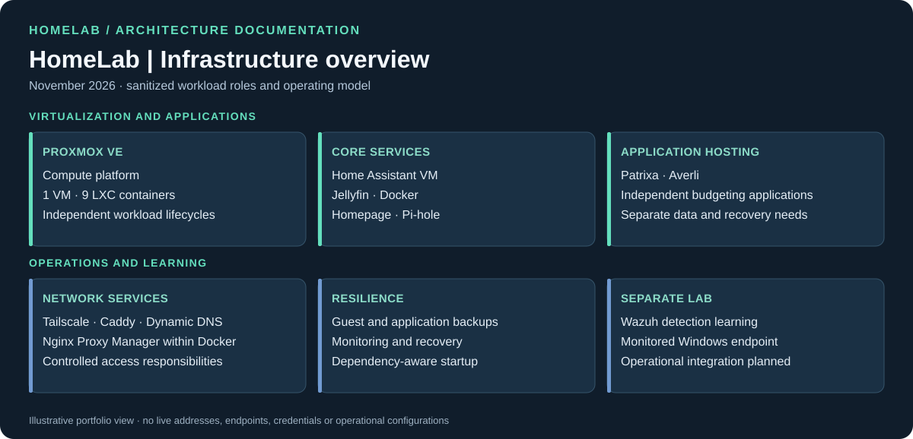
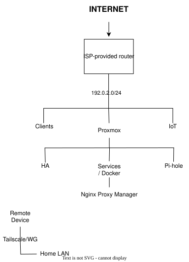

# HomeLab Architecture

> November 2026 inventory. This is a sanitized architecture description, not a complete deployment configuration. Addresses, guest identifiers, service endpoints and administrative identities are deliberately omitted.

## Overview

The HomeLab is a continuously operated Proxmox-based environment designed to practice virtualization, Linux administration, application hosting, networking, monitoring, secure operations and recovery.

*Historical architecture illustration; refer to the November workload inventory below for the current roles.*

The infrastructure evolved from a laptop server into a Lenovo ThinkCentre M720q Tiny platform. Its design separates workload responsibilities, keeps management access distinct from application access, and treats monitoring and recovery as part of the infrastructure lifecycle.

## Physical infrastructure

| Component | Role |
| --- | --- |
| Lenovo ThinkCentre M720q Tiny | Main compute node |
| Intel Core i5-8500T | Compute and virtualization |
| Intel UHD Graphics 630 | Media hardware acceleration |
| 16 GB DDR4 | Shared host memory |
| 256 GB NVMe SSD | System and guest storage |
| External HDD | Shared media and local backup storage |
| Residential gateway and Ethernet | Network connectivity |

The current platform uses a single main compute node. Planned hardware expansion focuses on backup independence, capacity, managed networking and power protection.

## Virtualization layer

The November inventory confirms **one virtual machine and nine LXC containers**. Docker application containers run within the dedicated Docker workload.

| Workload | Type | Responsibility |
| --- | --- | --- |
| Home Assistant OS | VM | Smart-home platform |
| Jellyfin | LXC | Media streaming |
| Docker | LXC | Containerized applications |
| Tailscale | LXC | VPN connectivity |
| Homepage | LXC | Operational dashboard |
| Pi-hole | LXC | Local DNS and filtering |
| Patrixa | LXC | Budgeting application |
| Caddy | LXC | Reverse proxy and HTTPS |
| Dynamic DNS | LXC | DNS record maintenance |
| Averli | LXC | Budgeting application |

This is an inventory of workload roles rather than a map of live network paths. Each workload can have an independent resource allocation, maintenance cycle and recovery procedure. Automatic startup and dependency-aware startup ordering are configured to improve recovery after a host restart.

### Virtual machines and containers

Home Assistant runs in a dedicated VM because it is an appliance-style workload with its own lifecycle, integrations and hardware requirements. LXC provides a lightweight way to separate suitable Linux services. Docker is used for application services whose containerized packaging simplifies lifecycle and dependency management.

Virtualization boundaries do not replace independently verified access policies. Workload isolation should be chosen according to risk, not only resource efficiency.

## Application and service layers

### Smart-home platform

Home Assistant integrates local automation, Zigbee, Bluetooth proxies and Wi-Fi-connected devices. MQTT and camera/object-detection integrations have been explored; their operational status remains subject to verification. Private household information is not part of the public documentation.

[Home Assistant](home-assistant.md)

### Media infrastructure

Jellyfin is hosted in a dedicated LXC and uses shared external media storage and Intel hardware acceleration through VA-API. Media-management applications run in the separate Docker workload. Media data and application configuration have different lifecycle and recovery needs.

[Jellyfin](jellyfin.md) · [Docker and media stack](docker-media-stack.md)

### Independent application hosting

Patrixa and Averli are two separate self-hosted budgeting applications, each deployed in its own environment. The former general-purpose WebApp workload now hosts Patrixa; it is not classified as an active security-testing environment.

Averli uses PostgreSQL, native authentication, PWA support, scheduled database backups and an isolated restore verification procedure. Patrixa's internal architecture and recovery procedure will be documented after verification.

[Application hosting](application-hosting.md)

## Networking and access

Pi-hole provides local name resolution and DNS filtering. Nginx Proxy Manager and Caddy coexist as independent reverse-proxy components. A separate dynamic DNS workload manages DNS records.

Administrative access is intended to remain private through VPN-based connectivity. Selected application access is handled through managed HTTPS. These are distinct access purposes, and a proxy is not a substitute for application authentication, authorization or network access policy.

*Earlier networking illustration; the text above describes the updated access roles.*

[Networking](networking.md)

## Shared storage and resilience

The main host provides storage integration for workloads that need media or backup data. Access is limited to the required workload roles and authenticated file sharing.

The storage incident recorded in the recovery documentation reinforces three principles:

- Assess the state of storage before performing modifications.
- Keep snapshots and backups conceptually separate.
- Aim for independent backup failure domains and verify restorability.

[Backup and recovery](backup-recovery.md)

## Monitoring and observability

Prometheus and Grafana provide time-series metrics and visualizations. Uptime Kuma monitors availability, with Netdata, Glances, Homepage and maintenance tools supporting operational visibility.

Availability and performance monitoring complement security monitoring, but do not provide equivalent coverage. The Wazuh lab is operated as a separate learning environment; integration with the primary infrastructure is a planned step.

[Monitoring](monitoring.md) · [Lab environment](lab-environment.md)

## Architectural decisions and learning

| Decision | Rationale |
| --- | --- |
| Dedicated appliance VM | Independent lifecycle and appliance requirements |
| Dedicated media LXC | Workload separation and hardware acceleration |
| Dedicated Docker workload | Independent management of application containers |
| Dedicated DNS service | Separation of a foundational network service from application maintenance |
| Independent application containers | Different application lifecycles, data and recovery requirements |
| Separate administrative and application access | Clearer access policy and reduced unnecessary exposure |
| Independent security learning environment | Keep controlled exercises separate from operational services |

The project is intentionally practical rather than enterprise-grade. Network-policy verification, backup independence, centralized security telemetry and reproducible configuration examples are the next architectural priorities.

## Related documentation

- [Networking](networking.md)
- [Application hosting](application-hosting.md)
- [Cybersecurity](cybersecurity.md)
- [Backup and recovery](backup-recovery.md)
- [Lessons learned](lessons-learned.md)
