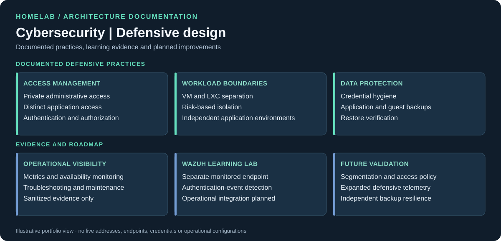

# Cybersecurity Design

> November 2026 update. This portfolio documents defensive architecture, security engineering decisions and learning outcomes. Live service mappings, operational security configuration, credentials and exact infrastructure versions are excluded.

## Security objectives

- Keep administrative access distinct from intended application access.
- Apply least privilege and appropriate workload isolation.
- Protect credentials, private information and application data.
- Maintain recoverability and security-relevant operational visibility.
- Separate controlled learning exercises from operational infrastructure.
- Verify controls and distinguish deployed capabilities from future plans.

*Historical security illustration; use the written controls and roadmap below for the current account.*

## Implemented security practices

| Area | Documented practice |
| --- | --- |
| Remote administration | VPN-based private access |
| Workload separation | VMs and LXC containers chosen according to workload needs |
| DNS | Dedicated local DNS and filtering |
| Application access | Independent reverse proxies for selected application roles; HTTPS where intended |
| File sharing | Authenticated access and legacy protocol restrictions |
| Credentials | Secrets and private configuration excluded from public documentation |
| Maintenance | Planned updates, snapshots and recovery procedures |
| Backup | Guest backups, application backups and restore verification |

These are documented design practices; a live independent security assessment has not been performed for this repository. The existence of a tool or configuration is not proof that a control is effective.

## Access and trust boundaries

Administrative access is intended to remain private. Selected application access is a distinct responsibility managed through appropriate application routing and authentication. The repository does not identify live access paths or backend endpoints.

Patrixa and Averli are independently deployed budgeting applications, not test targets. Their data requires appropriate confidentiality, integrity and recovery controls. The former WebApp workload is now used for application hosting, and controlled security exercises are assigned to a separate learning environment.

Compute isolation, application authentication and network-policy enforcement are complementary controls rather than interchangeable guarantees. Network segmentation and access-policy validation remain important areas of development.

## Threat model

A useful threat model starts with assets, intended access and appropriate controls.

| Asset class | Security objective | Defensive consideration |
| --- | --- | --- |
| Management interfaces | Authorized administration only | Private access, strong authentication, maintenance |
| Application data | Confidentiality and integrity | Authentication, authorization, secure data handling and backups |
| Smart-home information | Household privacy | Local control where appropriate, restricted access and sanitization |
| Infrastructure configuration | Integrity and confidentiality | Change review, separate secrets, recoverable configuration |
| Logs and metrics | Reliable visibility without unnecessary disclosure | Access restrictions, retention and sanitized reporting |
| Backup data | Recoverability and integrity | Independent copies, retention and restore verification |

The public documentation intentionally presents the threat model without a live asset-to-endpoint inventory. Detailed risk assessments and configuration records remain private.

## Monitoring and detection

Operational monitoring tools provide service availability and system metrics, which aid troubleshooting and capacity planning.

A separate **Wazuh SIEM lab** has been established in a virtualized test environment. A monitored Windows endpoint and an end-to-end authentication-failure detection test were confirmed in the project notes. This evidence is distinct from monitoring of the operational Proxmox infrastructure.

The next defensive learning objectives include:

- Verify and expand endpoint telemetry.
- Investigate and document alerts using controlled events.
- Establish repeatable, privacy-conscious evidence collection.
- Evaluate centralized security logging from the wider infrastructure.
- Develop network monitoring and segmentation validation in a dedicated environment.

[Lab environment and Wazuh](lab-environment.md)

## Secrets and portfolio privacy

Real credentials, API tokens, authentication material, household information, internal identifiers and live endpoints are excluded. Sanitized example values must not be mistaken for production configuration.

The repository uses editable architecture diagrams and documentation as learning artifacts. Screenshots and logs should be stripped of sensitive information before being shared; historical material may need separate review.

## Recovery and resilience

Snapshots enable convenient rollback, but backups serve a different purpose. Independent storage, retention, capacity monitoring and restore verification are essential for an effective recovery strategy.

Averli's scheduled PostgreSQL backups and isolated restore verification provide an application-level recovery example. The corresponding Patrixa procedures will be documented when verified.

[Backup and recovery](backup-recovery.md) · [Application hosting](application-hosting.md)

## Security roadmap

| Area | Objective |
| --- | --- |
| Network policies | Stronger segmentation and verified trust-zone separation |
| Access hardening | Review administrative access, authentication and credential lifecycle |
| Detection engineering | Expand Wazuh learning and integrate appropriate operational telemetry |
| Backup resilience | Independent failure domains, capacity alerts and repeatable restore tests |
| Application security | Review application boundaries, maintenance and recovery controls |
| Automation | Version-controlled examples and safe configuration validation |

The roadmap is intentionally separate from implemented practices. The HomeLab is a learning environment and not an assertion of enterprise-grade security.

## Related documentation

- [Architecture](architecture.md)
- [Networking](networking.md)
- [Monitoring](monitoring.md)
- [Lab environment](lab-environment.md)
- [Lessons learned](lessons-learned.md)
