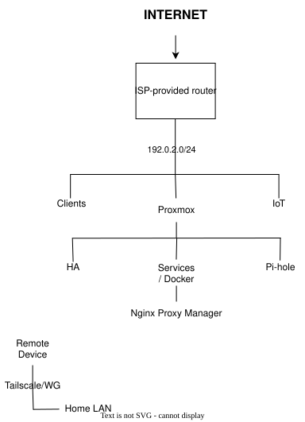

# Networking

> November 2026 update. This document describes service responsibilities and architectural principles, not a live network map. All deployment-specific addresses, DNS records, service mappings and firewall details remain private.

## Overview

Networking connects the infrastructure, application and management layers. The HomeLab uses local DNS, VPN connectivity, reverse proxies and network observability to support controlled access and maintainability.

## Network roles

| Component | Responsibility |
| --- | --- |
| Residential gateway and Ethernet | Network connectivity |
| Proxmox networking | Virtualized workload connectivity |
| Pi-hole | Local DNS resolution and DNS filtering |
| Tailscale / WireGuard | VPN-based connectivity |
| Nginx Proxy Manager | Reverse proxying for selected applications |
| Caddy | Independent reverse proxy and HTTPS |
| Dynamic DNS | DNS record maintenance |

These components are distinct responsibilities, not evidence that every service uses the same access path.

## DNS architecture

Pi-hole runs in a dedicated workload. It provides local name resolution, DNS filtering and visibility into DNS activity. Keeping this foundational service separate from application-container maintenance improves operational independence.

DNS is used for name resolution and filtering; it is not an authentication system, a firewall or a complete security control. The public repository does not include live DNS records or the mapping between service names and internal addresses.

The dynamic DNS workload maintains DNS records as part of the broader application-access architecture. Its provider configuration, record values and credentials are deliberately omitted.

## Reverse proxy architecture

Nginx Proxy Manager and Caddy are both present in the current inventory. Nginx Proxy Manager remains within the Docker workload, while Caddy runs as an independent workload. They serve selected applications according to their respective responsibilities.

Caddy is used for managed HTTPS application access. This does not imply that all services are public, that administrative services are public, or that the two proxies form a single mandatory chain.

The design benefits of proxying include:

- Consistent application naming and routing.
- Centralized certificate and HTTPS management.
- Independent maintenance of proxy configuration and application workloads.
- A consistent place to apply appropriate access policy.

A reverse proxy is not a firewall. Backend applications still need authentication, authorization, secure configuration and timely maintenance.

## Remote access

VPN technologies are used to support administrative and other intended private connectivity. Application access and management access have different trust requirements.

Remote management should be performed through approved private access channels. Public-facing application access, where deliberately configured, should be treated as a separate security responsibility. Live endpoint details, route lists, VPN peer configuration and access policy are not reproduced in this portfolio.

## Docker networking and connectivity

The dedicated Docker workload has its own application network requirements. Docker networks, container boundaries and broader network security zones address different isolation problems.

Applications should expose only the interfaces required for their intended role. Network and application policy should be tested independently of container deployment status.

The media stack also uses VPN separation for selected outbound traffic. This is a different purpose from VPN-based administrative access.

## Network observability

Network-related visibility is supported by DNS telemetry, uptime monitoring, time-series metrics and operational dashboards. Security-event collection and correlation are being developed through a separate Wazuh learning lab and form part of the broader roadmap.

[Monitoring and observability](monitoring.md) · [Cybersecurity](cybersecurity.md)

## Segmentation roadmap

A target design distinguishes management, application services, IoT, guest connectivity and controlled laboratory workloads. The intended objective is explicit access policy between trust zones and independent verification of those policies.

This is a roadmap, not a claim of a deployed VLAN or firewall policy. Deployment-specific rules and the present network state are maintained privately.

## Lessons and validation

- DNS, reverse proxying, access control and firewalling serve different purposes.
- Virtualization and container isolation are not equivalent to network segmentation.
- Remote administration and outbound traffic privacy have different objectives.
- A healthy dashboard does not by itself prove that a security boundary works.
- Configuration documentation should distinguish observed state, implemented design and planned changes.

Future validation will focus on management-access review, application access-policy checks, backup of configuration, and sanitized evidence of network monitoring and segmentation when implemented.

## Related documentation

- [Architecture](architecture.md)
- [Cybersecurity design](cybersecurity.md)
- [Monitoring](monitoring.md)
- [Application hosting](application-hosting.md)
- [Lab environment](lab-environment.md)
